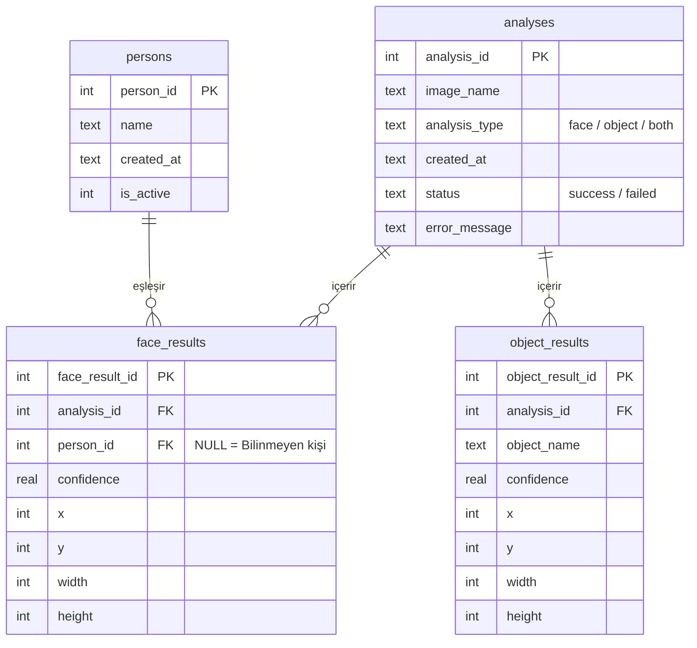

# yms301-yuz-ve-nesne-tanima
Bu proje, Python ve görüntü işleme teknikleri kullanılarak geliştirilen bir yüz ve nesne tanıma sistemidir.

## Proje Hakkında
Sistem, kullanıcı tarafından verilen görüntüleri analiz ederek görüntü içerisindeki yüzleri ve belirlenen nesneleri tespit etmeyi ve tanımayı amaçlamaktadır. Proje kapsamında görüntü işleme, yüz tanıma ve nesne tespiti yöntemleri kullanılacaktır.

## Kullanılacak Teknolojiler
- Python
- OpenCV
- Görüntü işleme

## YOLO Nesne Tespiti Modülü

Proje kapsamında geliştirilen YOLO modülü, verilen görüntülerdeki nesneleri tespit eder ve her tespit için aşağıdaki bilgileri döndürür:

Nesne etiketi: Tespit edilen nesnenin sınıfı.

Güven skoru: Modelin tespit sonucuna ilişkin güven değeri.

Koordinatlar: Tespit edilen nesnenin sınırlayıcı kutusunun x1, y1, x2, y2 koordinatları.

Modül dosyası:

src/core/object_detection.py

## Kurulum

Projeyi bilgisayarınıza indirdikten sonra proje ana klasöründe bir Python sanal ortamı oluşturun ve etkinleştirin.

Windows PowerShell:

py -m venv .venv
.\.venv\Scripts\Activate.ps1
python -m pip install -r requirements.txt

YOLO model dosyası yolo26n.pt, modülün beklediği şekilde proje ana klasöründe bulunmalıdır. Model dosyası GitHub deposuna eklenmez; ilk kurulumda ayrıca edinilmesi gerekir.

## Kullanım

Proje ana klasöründe aşağıdaki komutla nesne tespiti fonksiyonu çalıştırılabilir:

python -c "from src.core.object_detection import detect_objects; print(detect_objects('bus.jpg'))"

bus.jpg yerine analiz edilecek görüntünün dosya yolu kullanılabilir.

Fonksiyon, her tespit için label, confidence ve box alanlarını içeren bir liste döndürür. Belirtilen görüntü bulunamazsa FileNotFoundError hatası oluşturur.

## Testler

Otomatik testleri çalıştırmak için önce test aracını kurun:

python -m pip install pytest

Ardından:

python -m pytest tests/test_object_detection.py -v

YOLO modülü için iki otomatik test uygulanmıştır:

Geçerli bir görüntüden nesne tespit sonuçlarının döndürülmesi.

Görüntü bulunamadığında uygun hatanın oluşturulması.

Son test çalıştırmasında iki test de başarılı olmuştur.

## Veritabanı Katmanı

Uygulamanın tüm verisi SQLite ile `data/project.db` dosyasında tutulur.
Kayıtlı kişiler, yapılan analizler ve bu analizlerde bulunan yüz ve nesne sonuçları burada saklanır.
Diğer modüller veritabanına doğrudan SQL yazmaz; tüm işlemler `database.py` içindeki fonksiyonlarla yapılır.

### Tablolar



| Tablo | İçerik |
|---|---|
| `persons` | İzinli kayıtlı kişiler: ad, kayıt tarihi, aktif/pasif durumu |
| `analyses` | Her analiz: görsel adı, analiz türü, durum ve varsa hata mesajı |
| `face_results` | Bulunan yüzler: kutu konumu, güven skoru, eşleşen kişi |
| `object_results` | Bulunan nesneler: sınıf adı, güven skoru, kutu konumu |

### Veri kuralları

- Bir analiz silinince ona ait tüm yüz ve nesne sonuçları da silinir (`ON DELETE CASCADE`).
- Bir kişi silinince eski yüz sonuçları korunur ve "Bilinmeyen kişi" olarak görünür (`ON DELETE SET NULL`).
- Güven skorları 0 ile 1 arasında olmalıdır. Kutu değerleri negatif olamaz.
- Analiz türü yalnızca `face`, `object` veya `both` olabilir.
- Bir analiz ve tüm sonuçları tek işlemde (transaction) kaydedilir. Sonuçlardan biri hatalıysa hiçbiri kaydedilmez.
- Kayıt zamanları (`created_at`) UTC olarak tutulur.

### Fonksiyonlar

| Fonksiyon | Görevi |
|---|---|
| `initialize_database()` | Tablolar yoksa oluşturur |
| `add_person(name)` | Kişi ekler, `person_id` döndürür |
| `get_person(person_id)` | Kişiyi getirir, yoksa `None` |
| `list_persons(only_active=True)` | Kişileri ada göre sıralı listeler |
| `set_person_active(person_id, is_active)` | Kişiyi silmeden pasif/aktif yapar |
| `delete_person(person_id)` | Kişiyi tamamen siler (izin geri çekildiğinde) |
| `save_analysis(image_name, analysis_type, face_results, object_results)` | Başarılı analizi sonuçlarıyla kaydeder, `analysis_id` döndürür |
| `save_failed_analysis(image_name, analysis_type, error_message)` | Başarısız analizi hata mesajıyla kaydeder |
| `get_analysis_history(limit=50, analysis_type=None)` | Geçmişi en yeniden eskiye, yüz/nesne sayılarıyla getirir |
| `get_analysis_details(analysis_id)` | Tek bir analizin tüm sonuçlarını getirir |
| `delete_analysis(analysis_id)` | Analizi ve sonuçlarını siler |

Hatalı girdilerde `ValueError`, SQLite kaynaklı hatalarda `DatabaseError` fırlatılır.
Tüm işlemler `logging` ile loglanır.

### Testler

```powershell
pytest tests/test_database.py -v
```

Her test geçici bir veritabanı kullanır, gerçek `data/project.db` etkilenmez.
23 test şunları kontrol eder:

- tabloların oluşması ve yabancı anahtarların açık olması,
- kişi ekleme, listeleme, pasif yapma ve silme,
- yüz ve nesne sonuçlarıyla analiz kaydı,
- hatalı girdilerin reddedilmesi (geçersiz tür, skor, kutu),
- hatalı kayıtta tüm işlemin geri alınması,
- geçmişin sırası, sayıları ve filtreleri,
- analiz silinince sonuçların da silinmesi.
- 
## Yüz Tanıma Modülü

**Durum:** Yöntem araştırması ve yüz tespiti denemesi tamamlandı. Modül dosyası (`src/core/face_recognition.py`) henüz yazılmadı, planlanan çalışma devam ediyor.

### Yöntem
- Yüz tespiti: OpenCV YuNet (ONNX)
- Yüz tanıma: OpenCV SFace (planlanan)
- Ayrıntılı gerekçe: [docs/face_method.md](docs/face_method.md)

### Model dosyası
Model dosyaları depoya eklenmez. `models/` klasörüne elle indirilir:

```powershell
mkdir models
curl.exe -L -o models\face_detection_yunet_2023mar.onnx https://github.com/opencv/opencv_zoo/raw/main/models/face_detection_yunet/face_detection_yunet_2023mar.onnx
```

### Önemli bulgu
YuNet çok büyük görsellerde (örn. 2048 px) güven skorunu düşürüyor. Bu yüzden görselin uzun kenarı yaklaşık 640 piksele küçültülüp tespit yapılacak, kutular orijinal boyuta geri ölçeklenecek.

### Veri güvenliği
Yalnızca izni alınmış kişilerin görselleri kullanılır. Test fotoğrafları ve biyometrik veriler depoya eklenmez.

## Proje Ekibi
- Zeynep Cemre KELEŞ
- Melike KAYA
- Nazar DEMİR

