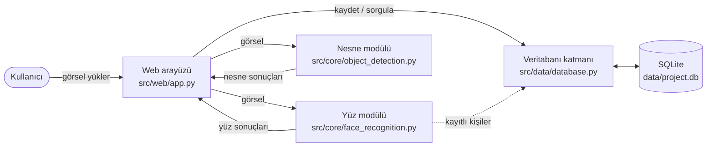
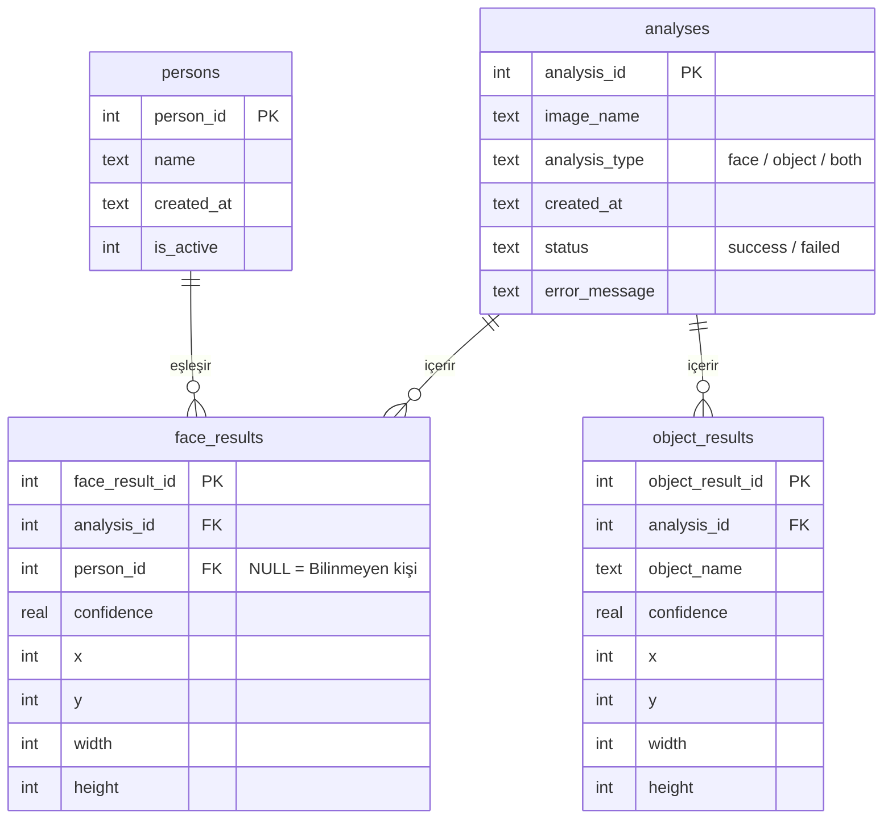

# Yüz ve Nesne Tanıma Sistemi

Python ile görüntü işleme tabanlı yüz ve nesne tanıma sistemi.
YMS301 dersi kapsamında 3 kişilik ekip tarafından geliştirilmektedir.

Kullanıcı web arayüzünden bir görsel yükler ve analiz türünü seçer. Sistem:

- görseldeki **yüzleri** bulur ve izinli kayıtlı kişilerle karşılaştırarak
  kişiyi veya **"Bilinmeyen kişi"** sonucunu verir,
- görseldeki **nesneleri** YOLO modeliyle tespit eder ve güven skorlarını verir,
- sonuçları görsel üzerinde kutularla işaretler ve **analiz geçmişine** kaydeder.

---

## İçindekiler

- [Teknolojiler](#teknolojiler)
- [Ekip ve görev dağılımı](#ekip-ve-görev-dağılımı)
- [Mimari](#mimari)
- [Klasör yapısı](#klasör-yapısı)
- [Veritabanı](#veritabanı)
- [Modüller arası veri formatı](#modüller-arası-veri-formatı)
- [Kurulum](#kurulum)
- [Çalıştırma](#çalıştırma)
- [Testler](#testler)
- [Ekran görüntüleri](#ekran-görüntüleri)
- [Gizlilik ve etik](#gizlilik-ve-etik)
- [Proje takvimi](#proje-takvimi)

---

## Teknolojiler

| Alan | Araç |
|---|---|
| Dil | Python 3.10+ |
| Web arayüzü | Streamlit |
| Görüntü işleme | OpenCV |
| Nesne tespiti | YOLO |
| Veritabanı | SQLite |
| Test | pytest |
| Sürüm kontrolü | Git ve GitHub |

---

## Ekip ve görev dağılımı

| Üye | Sorumluluk | Temel dosyalar |
|---|---|---|
| 1. kişi — *Ad Soyad* | Yüz tespiti ve kimlik eşleştirme | `src/core/face_recognition.py`, `tests/test_face_recognition.py` |
| 2. kişi — *Ad Soyad* | YOLO ile nesne tespiti | `src/core/object_detection.py`, `tests/test_object_detection.py` |
| 3. kişi — *Ad Soyad* | Veritabanı ve web uygulaması | `src/data/database.py`, `src/web/app.py`, `tests/test_database.py` |

Modüllerin girdi/çıktı formatları, web entegrasyonu, kod incelemeleri ve uçtan uca testler
ekipçe ortak yürütülür.

---

## Mimari

Her bileşen ayrı bir modüldür. Bileşenler birbirine yalnızca tanımlı fonksiyonlar
üzerinden bağlanır. `main.py` yalnızca uygulamayı başlatır; iş mantığı içermez.



**Analiz akışı**

1. Kullanıcı görseli yükler ve analiz türünü seçer: `face`, `object` veya `both`.
2. Web arayüzü görseli ilgili modüle veya modüllere gönderir.
3. Modüller sonuçları [ortak veri formatında](#modüller-arası-veri-formatı) döndürür.
4. Web arayüzü kutuları görsel üzerinde gösterir ve `save_analysis()` ile sonuçları kaydeder.
5. Hata olursa (bozuk görsel, model hatası vb.) `save_failed_analysis()` ile hata kaydedilir.
6. Geçmiş ekranı `get_analysis_history()` ve `get_analysis_details()` ile doldurulur.

Modeller uygulama başlarken **bir kez** yüklenir ve her analizde yeniden kullanılır.

---

## Klasör yapısı

```
yms301-yuz-ve-nesne-tanima/
├── main.py                       # Giriş noktası (yalnızca yönlendirme)
├── requirements.txt              # Gerekli Python paketleri
├── pytest.ini                    # Test ayarları
├── src/
│   ├── core/
│   │   ├── face_recognition.py   # Yüz tespiti ve kişi eşleştirme
│   │   └── object_detection.py   # YOLO ile nesne tespiti
│   ├── data/
│   │   └── database.py           # SQLite veritabanı katmanı
│   └── web/
│       └── app.py                # Streamlit arayüzü
├── tests/
│   ├── test_database.py
│   ├── test_face_recognition.py
│   └── test_object_detection.py
└── data/
    └── project.db                # Çalışınca oluşur, Git'e eklenmez
```

---

## Veritabanı

Veritabanı SQLite ile tutulur. Tüm erişim `src/data/database.py` üzerinden yapılır;
diğer modüller doğrudan SQL yazmaz.



| Tablo | İçerik |
|---|---|
| `persons` | İzinli kayıtlı kişiler: ad, kayıt tarihi, aktif/pasif durumu |
| `analyses` | Her analiz: görsel adı, analiz türü, durum ve varsa hata mesajı |
| `face_results` | Bulunan yüzler: kutu konumu, güven skoru, eşleşen kişi |
| `object_results` | Bulunan nesneler: sınıf adı, güven skoru, kutu konumu |

**Kurallar**

- Bir analiz silinince ona ait tüm yüz ve nesne sonuçları da silinir (`ON DELETE CASCADE`).
- Bir kişi silinince eski yüz sonuçları korunur ve "Bilinmeyen kişi" olarak görünür (`ON DELETE SET NULL`).
- Güven skorları 0 ile 1 arasında, kutu değerleri negatif olmayan tam sayılar olmalıdır.
- Bir analiz ve sonuçları tek işlemde (transaction) kaydedilir; hata olursa hiçbiri kaydedilmez.

**Başlıca fonksiyonlar**

| Fonksiyon | Görevi |
|---|---|
| `initialize_database()` | Tabloları oluşturur |
| `add_person()`, `list_persons()`, `set_person_active()`, `delete_person()` | Kişi yönetimi |
| `save_analysis()` | Başarılı analizi tüm sonuçlarıyla kaydeder |
| `save_failed_analysis()` | Başarısız analizi hata mesajıyla kaydeder |
| `get_analysis_history()` | Geçmişi en yeniden eskiye, yüz/nesne sayılarıyla getirir |
| `get_analysis_details()` | Tek bir analizin tüm sonuçlarını getirir |
| `delete_analysis()` | Analizi ve sonuçlarını siler |

---

## Modüller arası veri formatı

Yüz ve nesne modülleri sonuçlarını aşağıdaki formatta **liste** olarak döndürür.
Koordinatlar piksel cinsindendir; `(x, y)` kutunun sol üst köşesidir.

**Yüz sonucu**

```python
{
    "person_id": 3,        # Eşleşme yoksa None → "Bilinmeyen kişi"
    "confidence": 0.87,    # 0–1 arası; bilinmiyorsa None
    "box": {"x": 10, "y": 20, "width": 50, "height": 60},
}
```

**Nesne sonucu**

```python
{
    "object_name": "laptop",
    "confidence": 0.95,    # 0–1 arası, zorunlu
    "box": {"x": 10, "y": 20, "width": 50, "height": 60},
}
```

Ondalıklı koordinatlar kayıt sırasında tam sayıya yuvarlanır.

---

## Kurulum

Gereksinimler: Python 3.10 veya üstü, Git.

```powershell
# 1. Depoyu klonlayın
git clone https://github.com/KULLANICI_ADI/yms301-yuz-ve-nesne-tanima.git
cd yms301-yuz-ve-nesne-tanima

# 2. Sanal ortam oluşturup etkinleştirin
python -m venv venv
.\venv\Scripts\Activate.ps1        # Windows (PowerShell)
# source venv/bin/activate         # macOS / Linux

# 3. Paketleri yükleyin
pip install -r requirements.txt

# 4. Veritabanını oluşturun
python -m src.data.database
```

> PowerShell `Activate.ps1` çalıştırmaya izin vermezse bir kez şunu çalıştırın:
> `Set-ExecutionPolicy -Scope CurrentUser RemoteSigned`

Sanal ortam klasörü (`venv/`), veritabanı dosyası (`data/*.db`) ve büyük model dosyaları
`.gitignore` ile depo dışında tutulur.

---

## Çalıştırma

```powershell
streamlit run src/web/app.py
```

Tarayıcıda `http://localhost:8501` adresi açılır.

> Web arayüzü geliştirme aşamasındadır (3. hafta itibarıyla eklenecek).

---

## Testler

Tüm testleri çalıştırmak için proje kök dizininde:

```powershell
pytest -v
```

Yalnızca tek bir modülün testleri:

```powershell
pytest tests/test_database.py -v
```

Veritabanı testleri her test için geçici bir veritabanı kullanır;
gerçek `data/project.db` dosyası etkilenmez.

| Test dosyası | Kapsam | Durum |
|---|---|---|
| `tests/test_database.py` | Tablo kurulumu, kişi işlemleri, analiz kaydı, hatalı girdiler, geçmiş sorguları | 23 test ✅ |
| `tests/test_face_recognition.py` | Yüz modülü | Hazırlanıyor |
| `tests/test_object_detection.py` | Nesne modülü | Hazırlanıyor |

---

## Ekran görüntüleri

> Web arayüzü tamamlandığında eklenecektir.

<!--
Görselleri docs/images/ klasörüne koyup şu şekilde ekleyin:


-->

---

## Gizlilik ve etik

- Yüz tanıma için **yalnızca izin alınmış** kişilerin örnekleri kullanılır.
- Biyometrik veriler gereğinden fazla saklanmaz. Kişi izni geri çektiğinde
  `delete_person()` ile kaydı tamamen silinir.
- Veritabanı dosyası ve kişi görselleri GitHub deposuna **eklenmez**.

---

## Proje takvimi

| Hafta | 1. kişi: Yüz | 2. kişi: Nesne | 3. kişi: Web / Veri |
|---|---|---|---|
| 1 | Yüz yöntemi araştırması | YOLO araştırması | Mimari ve DB taslağı ✅ |
| 2 | Yüz tespit prototipi | Nesne tespit prototipi | SQLite tabloları ve fonksiyonları ✅ |
| 3 | Kişi eşleştirme | Sonuç formatı ve skorlar | Streamlit ilk ekranı |
| 4 | Yüz modülü iyileştirme | Nesne modülü iyileştirme | Yükleme ve DB bağlantısı |
| 5 | Yüz entegrasyonu | Nesne entegrasyonu | Ortak analiz akışı |
| 6 | Yüz testleri, hatalar | Nesne testleri, hatalar | Geçmiş ve DB testleri |
| 7 | Birim/entegrasyon testi | Birim/entegrasyon testi | Uçtan uca testler |
| 8 | Yüz dokümantasyonu | Nesne dokümantasyonu | Kurulum/README kontrolü |
