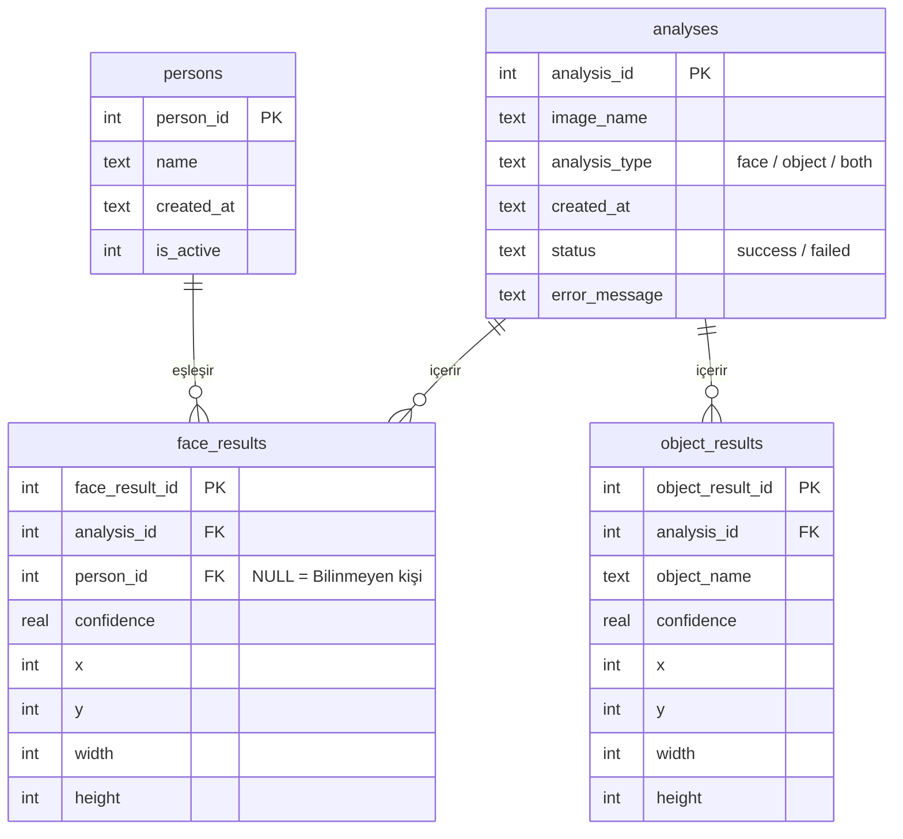

## Veritabanı Katmanı

**Sorumlu:** 3. kişi — *Ad Soyad*
**Dosyalar:** `src/data/database.py`, `tests/test_database.py`

Uygulamanın tüm verisi SQLite ile `data/project.db` dosyasında tutulur.
Kayıtlı kişiler, yapılan analizler ve bu analizlerde bulunan yüz ve nesne sonuçları burada saklanır.
Diğer modüller veritabanına doğrudan SQL yazmaz; tüm işlemler `database.py` içindeki fonksiyonlarla yapılır.

### Tablolar



| Tablo | İçerik |
|---|---|
| `persons` | İzinli kayıtlı kişiler: ad, kayıt tarihi, aktif/pasif durumu |
| `analyses` | Her analiz: görsel adı, analiz türü, durum ve varsa hata mesajı |
| `face_results` | Bulunan yüzler: kutu konumu, güven skoru, eşleşen kişi |
| `object_results` | Bulunan nesneler: sınıf adı, güven skoru, kutu konumu |

### Veri kuralları

- Bir analiz silinince ona ait tüm yüz ve nesne sonuçları da silinir (`ON DELETE CASCADE`).
- Bir kişi silinince eski yüz sonuçları korunur ve "Bilinmeyen kişi" olarak görünür (`ON DELETE SET NULL`).
- Güven skorları 0 ile 1 arasında olmalıdır. Kutu değerleri negatif olamaz.
- Analiz türü yalnızca `face`, `object` veya `both` olabilir.
- Bir analiz ve tüm sonuçları tek işlemde (transaction) kaydedilir. Sonuçlardan biri hatalıysa hiçbiri kaydedilmez.
- Kayıt zamanları (`created_at`) UTC olarak tutulur.

### Fonksiyonlar

| Fonksiyon | Görevi |
|---|---|
| `initialize_database()` | Tablolar yoksa oluşturur |
| `add_person(name)` | Kişi ekler, `person_id` döndürür |
| `get_person(person_id)` | Kişiyi getirir, yoksa `None` |
| `list_persons(only_active=True)` | Kişileri ada göre sıralı listeler |
| `set_person_active(person_id, is_active)` | Kişiyi silmeden pasif/aktif yapar |
| `delete_person(person_id)` | Kişiyi tamamen siler (izin geri çekildiğinde) |
| `save_analysis(image_name, analysis_type, face_results, object_results)` | Başarılı analizi sonuçlarıyla kaydeder, `analysis_id` döndürür |
| `save_failed_analysis(image_name, analysis_type, error_message)` | Başarısız analizi hata mesajıyla kaydeder |
| `get_analysis_history(limit=50, analysis_type=None)` | Geçmişi en yeniden eskiye, yüz/nesne sayılarıyla getirir |
| `get_analysis_details(analysis_id)` | Tek bir analizin tüm sonuçlarını getirir |
| `delete_analysis(analysis_id)` | Analizi ve sonuçlarını siler |

Hatalı girdilerde `ValueError`, SQLite kaynaklı hatalarda `DatabaseError` fırlatılır.
Tüm işlemler `logging` ile loglanır.

### Beklenen sonuç formatı

`save_analysis()` yüz ve nesne sonuçlarını aşağıdaki formatta bir **liste** olarak bekler.
Koordinatlar piksel cinsindendir ve `(x, y)` kutunun sol üst köşesidir.
Ondalıklı koordinatlar kayıt sırasında tam sayıya yuvarlanır.

```python
# Yüz sonucu
{"person_id": 3, "confidence": 0.87,
 "box": {"x": 10, "y": 20, "width": 50, "height": 60}}
# person_id None ise "Bilinmeyen kişi" sayılır; confidence None olabilir.

# Nesne sonucu
{"object_name": "laptop", "confidence": 0.95,
 "box": {"x": 10, "y": 20, "width": 50, "height": 60}}
```

### Kullanım örneği

```python
from src.data import database as db

db.initialize_database()

ayse_id = db.add_person("Ayşe")

analysis_id = db.save_analysis(
    "sinif.jpg",
    "both",
    face_results=[
        {"person_id": ayse_id, "confidence": 0.87,
         "box": {"x": 10, "y": 20, "width": 50, "height": 60}},
    ],
    object_results=[
        {"object_name": "laptop", "confidence": 0.95,
         "box": {"x": 100, "y": 80, "width": 200, "height": 150}},
    ],
)

for analysis in db.get_analysis_history(limit=10):
    print(analysis["image_name"], analysis["face_count"], analysis["object_count"])

details = db.get_analysis_details(analysis_id)
print(details["faces"][0]["person_name"])   # "Ayşe"
```

### Veritabanını oluşturma

Proje kök dizininde:

```powershell
python -m src.data.database
```

`data/project.db` dosyası oluşur. Bu dosya kişi verisi içerdiği için `.gitignore` ile
depo dışında tutulur; her geliştirici kendi veritabanını bu komutla oluşturur.

### Testler

```powershell
pytest tests/test_database.py -v
```

Her test geçici bir veritabanı kullanır, gerçek `data/project.db` etkilenmez.
23 test şunları kontrol eder:

- tabloların oluşması ve yabancı anahtarların açık olması,
- kişi ekleme, listeleme, pasif yapma ve silme,
- yüz ve nesne sonuçlarıyla analiz kaydı,
- hatalı girdilerin reddedilmesi (geçersiz tür, skor, kutu),
- hatalı kayıtta tüm işlemin geri alınması,
- geçmişin sırası, sayıları ve filtreleri,
- analiz silinince sonuçların da silinmesi.
